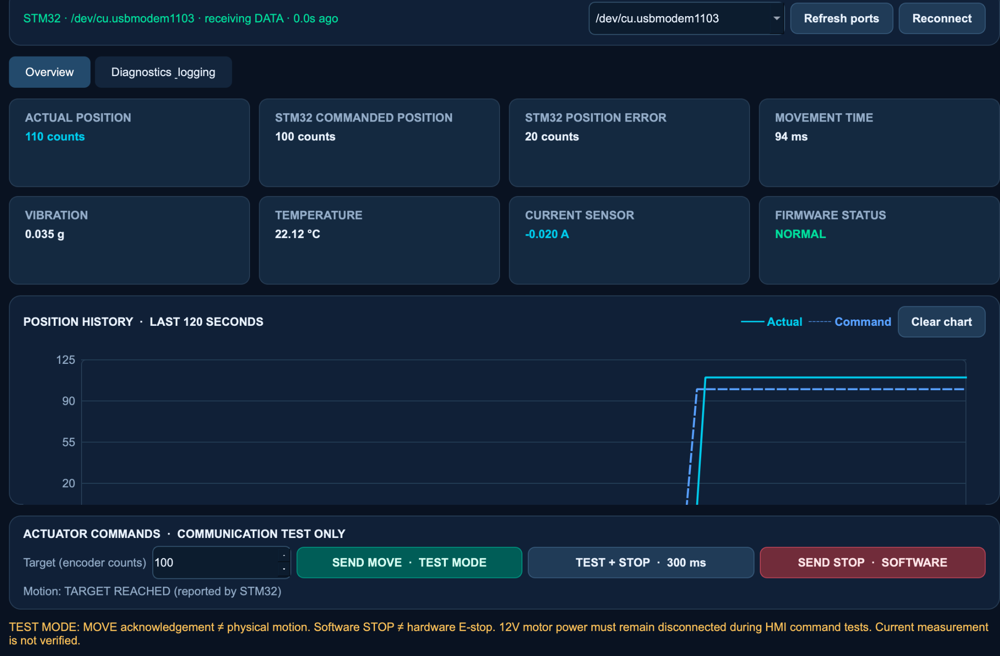

# Aircraft Actuator Control and Test Platform

## Project Overview

The Aircraft Actuator Control and Test Platform is an embedded systems project focused on controlling and testing a motor-driven actuator. It brings together motor control, position feedback, sensor measurements, PLC communication, and a desktop interface. The setup is inspired by aerospace actuator testing, using a 12 V DC geared motor as a prototype rather than an aircraft-certified actuator.

An **STM32 NUCLEO-F446RE** handles motor control, encoder feedback, sensor readings, and communication. A **CLICK PLUS PLC** exchanges data with the STM32 over **Modbus TCP**, while a **Python-based HMI** provides live monitoring and command testing.

Motor operation, encoder feedback, Ethernet communication, basic PLC logic, and HMI communication have been tested. Full closed-loop positioning and physical safety functions are still under development.

## Hardware and Software

| Component | Purpose |
|---|---|
| STM32 NUCLEO-F446RE | Main controller and embedded firmware |
| 12 V geared DC motor + driver | PWM motor control |
| Quadrature encoder | Position feedback |
| WIZ550IO / W5500 | Ethernet connection over SPI |
| CLICK PLUS C2-01CPU | PLC communication and Ladder Logic |
| DS18B20 | Motor temperature readings |
| ADXL345 | Vibration measurements over I²C |
| ACS724 | Current sensing (still being tested) |
| Python, PySide6, PySerial | Desktop HMI on macOS |
| STM32CubeIDE, Embedded C, STM32 HAL | Firmware development |

## System Architecture

```text
                  Mac HMI (Python / PySide6)
                            |
                       USB / UART
                            |
                    STM32 NUCLEO-F446RE
                     /       |       \
               TIM3 PWM  TIM4 Encoder  SPI1
                  |          ^          |
              Motor Driver   |       W5500 Ethernet
                  |          |          |
                12 V Motor --+       Modbus TCP
                                         |
                                  CLICK PLUS PLC

STM32 sensors:
  I²C    -> ADXL345 vibration sensor
  1-Wire -> DS18B20 temperature sensor
  ADC    -> ACS724 current sensor (not yet verified)
```

## 1. STM32 Motor Control

Motor output and encoder feedback were first tested directly through the STM32 firmware.

- Set up **TIM3 PWM at 20 kHz** to drive the motor through an external motor driver.
- Used GPIO pins for motor direction control.
- Verified physical motor rotation during a short PWM test.
- Configured **TIM4 in encoder mode** and verified that encoder counts changed during motor rotation.
- Developed an initial proportional position-control routine with position-error calculation, PWM adjustment, target tolerance, and a **5-second timeout**.

Motor rotation and encoder feedback have been verified. The position-control routine has not yet been connected to the HMI MOVE command for physical closed-loop operation.

### Sensors and STM32 Peripherals

The firmware also uses **UART** for HMI messages and debugging, **SPI** for the W5500, **I²C** for the ADXL345, **1-Wire** for the DS18B20, and **ADC** for current-sensor testing.

The ADXL345 provides vibration data for RMS calculation. DS18B20 temperature readings have occasionally been unstable, and ACS724 current measurements are not yet verified. The HMI also displays NORMAL, WARNING, and ERROR status information.

## 2. W5500 Ethernet Setup

A **WIZ550IO Ethernet module**, based on the W5500 controller, was connected to the STM32 through SPI1.

Ethernet setup was tested in stages:

1. Read the W5500 `VERSIONR` register and got the expected value, **`0x04`**.
2. Set a static IP address and read it back from the W5500 registers.
3. Checked the Ethernet link using the `PHYCFGR` register.
4. Verified network connectivity from macOS with **4 out of 4 successful ping replies**.
5. Set up a TCP server on **port 502** for Modbus TCP communication.

| Device | IP address |
|---|---|
| STM32 / W5500 | `192.168.1.50` |
| CLICK PLUS PLC | `192.168.1.60` |

During debugging, SPI register access, Ethernet link status, IP configuration, TCP connection, and Modbus responses were checked separately to identify communication issues.

## 3. Modbus TCP Between the PLC and STM32

The **CLICK PLUS C2-01CPU** communicates with the STM32 through the W5500 Ethernet module. The PLC operates as the **Modbus TCP client**, and the STM32/W5500 operates as the **server**.

The following Modbus function codes were tested:

| Function | Test performed |
|---|---|
| **FC06** – Write Single Register | Sent the value `123` from the PLC to the STM32 and checked the PLC success flag |
| **FC03** – Read Holding Registers | Read values back from the STM32, including temperature and vibration register tests |
| **FC16** – Write Multiple Registers | Sent a basic STOP command from the PLC and confirmed that the STM32 received function code `0x10` |

### Troubleshooting

**Modbus response timeouts.** The Ethernet link and TCP connection were active, but the PLC reported communication errors. Received Modbus frames, W5500 transmit buffers, socket states, and send flags were checked. Blocking sensor reads and delays in the STM32 main loop were found to interfere with timely responses. Temporarily disabling these reads improved communication; non-blocking sensor scheduling remains to be implemented.

**PLC register conflict.** During FC03 sensor testing, the Modbus exception-code destination overlapped with temperature register `DS4`. Moving the exception-code destination to `DS10` resolved the conflict and restored the expected temperature and vibration readings.

**FC16 trigger timing.** An earlier Ladder Logic version reset the send trigger before the FC16 request could reliably execute. Trigger conditions and a temporary timer were tested during troubleshooting. The final program was simplified to retain the basic communication functions.

## 4. CLICK PLC Ladder Logic

[View Complete PLC Ladder Logic (PDF)](docs/plc-ladder-logic.pdf)

The final CLICK PLUS program contains **18 rungs** and focuses on Modbus communication, heartbeat monitoring, and sending a STOP command. More complex run/fault latches and manual/automatic modes from earlier versions were removed.

### Heartbeat and Communication Status (Rungs 1–7)

- Compares the current heartbeat in `DS6` with the previous value stored in `DS31`.
- When the value changes, updates `DS31` and sets the `HeartbeatValid` flag (`C68`).
- Uses a **3-second timer (`T1`)** to detect when heartbeat updates stop.
- Sets `CommTimeout` (`C59`) on timeout and uses `CommOK` (`C52`) to indicate valid communication without a timeout.

### STOP Command and Modbus Read/Write (Rungs 8–17)

- A `StopPending` request (`C111`) copies **`0` into `DS20`** as the STOP command.
- When communication is available, `StopReady` (`C112`) generates a one-shot `StopPulse` (`C114`). The pulse increments the sequence value in `DS22` and sets `SendTrigger` (`C81`).
- A **500 ms timer (`T2`)** resets the send trigger. The **FC16** instruction writes **three registers starting at `DS20`** to the STM32.
- The **FC03** instruction reads **four holding registers into `DS3–DS6`**, including the heartbeat. Conditions on the send and receive instructions help coordinate the two operations.

### Main PLC Addresses

| Address | Purpose |
|---|---|
| `DS3–DS6` | Four registers read from the STM32; `DS6` holds the heartbeat |
| `DS31` | Previous heartbeat value |
| `DS20` | STOP command value (`0`) |
| `DS21` | Included in the three-register FC16 write; its application meaning is not established by the ladder diagram alone |
| `DS22` | Sequence value incremented for a STOP request |
| `C52` / `C59` | Communication OK / timeout |
| `C111` | `StopPending` request |
| `C112` / `C114` / `C81` | `StopReady` / `StopPulse` / `SendTrigger` |

Basic tests confirmed PLC register reads, heartbeat updates, and receipt of an FC16 STOP request by the STM32. This confirms **communication**, not physical stopping of a powered motor. The final program does not include the separate acknowledgment-read sequence used in earlier experiments.

## 5. Python HMI

### HMI Dashboard



A desktop HMI was developed using **Python, PySide6, and PySerial**, communicating with the STM32 over USB serial at **115200 baud**.

The interface includes:

- Live commanded position, encoder position, position error, and movement-time fields.
- Temperature, vibration, and system-status displays.
- A position-history graph.
- Target-position input and MOVE/STOP buttons.
- Serial-port selection, connection status, and timeout detection.
- A diagnostics panel, event logs, and log export.

### Command Tests

```text
HMI -> STM32: MOVE,1000
STM32 -> HMI: MOVE ACCEPTED | TEST MODE | Target:1000

HMI -> STM32: STOP
STM32 -> HMI: STOP CONFIRMED
```

The HMI displays live data and exchanges commands with the STM32. **MOVE currently operates in test mode** and does not trigger physical motor movement. The STOP response confirms command reception only; physical stopping performance has not been tested.

## 6. Test Results

| Test | Result |
|---|---|
| STM32 PWM motor rotation | Passed |
| TIM4 encoder feedback | Passed |
| W5500 SPI communication | Passed |
| Ethernet link and ping | Passed |
| Modbus TCP FC03, FC06, FC16 | Passed in basic tests |
| PLC heartbeat and STOP command communication | Passed |
| HMI live display and MOVE/STOP message exchange | Passed |
| HMI-controlled closed-loop motor positioning | Not yet tested |
| ACS724 current measurement | Not yet verified |
| Physical emergency stop and powered STOP behavior | Not yet tested |
| Long-duration system reliability | Not yet tested |

## 7. Firmware Architecture and Additional Interfaces

The current firmware uses **STM32 HAL with a main-loop structure**. The project architecture allows for future **FreeRTOS** task scheduling to separate motor control, sensor acquisition, and communication. **CAN**, **RS-485 / Modbus RTU**, and **Wi-Fi** are additional communication interfaces under consideration. Existing position-error and vibration RMS calculations also provide a basis for further **DSP** and fault-detection work.

These interfaces and RTOS features have not yet been implemented or verified.

## 8. Next Steps

- Finish testing and calibrating the ACS724 current sensor.
- Improve the DS18B20 wiring and sensor-read timing.
- Add a physical emergency-stop circuit and suitable electrical protection.
- Connect the HMI MOVE command to motor position control and test it safely.
- Test actual motor STOP behavior, fault handling, and communication loss.
- Run longer tests with the PLC, STM32, sensors, and HMI working together.
- If time permits, design a custom PCB to replace the breadboard setup and improve wiring and component integration.
---

**Project scope:** This is an engineering prototype, not a certified aircraft actuator controller. Software STOP commands do not replace a physical emergency-stop circuit.

